# HelpDesk

HelpDesk to aplikacja internetowa służąca do przeglądania zgłoszeń do pomocy technicznej i zarządzania nimi, sprawdzania statystyk zgłoszeń oraz aktualizowania danych konta.

## Strony

### Panel główny

Panel główny przedstawia przegląd aktywności związanej ze zgłoszeniami oraz statystyki dla administratora wraz z możliwością zarządzania zgłoszeniami.

Panel główny administratora

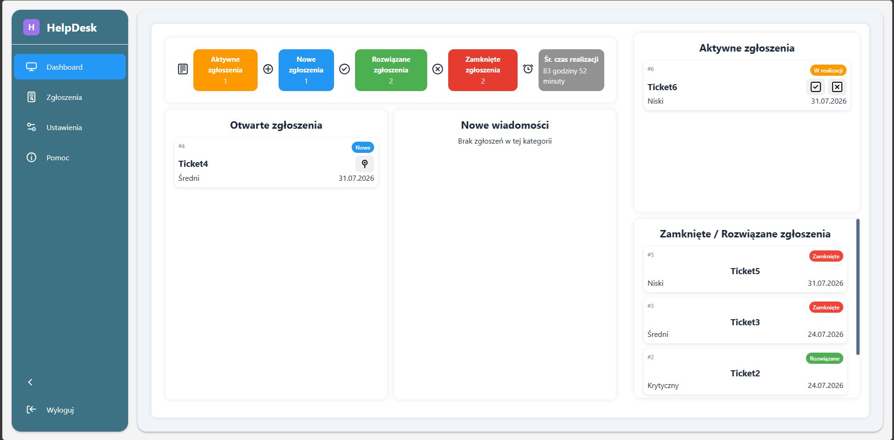

Panel główny użytkownika

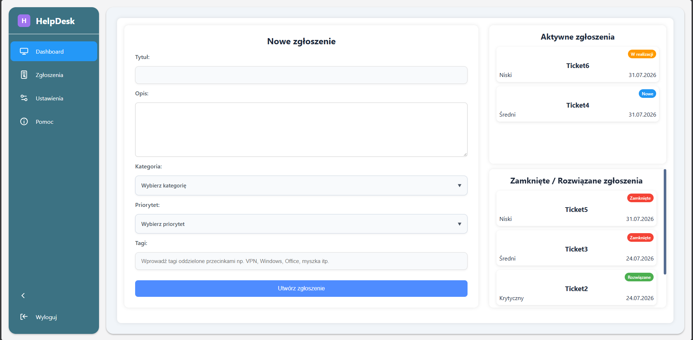

### Zgłoszenia

Strona zgłoszeń umożliwia użytkownikom przeglądanie zgłoszeń do pomocy technicznej oraz zarządzanie nimi.

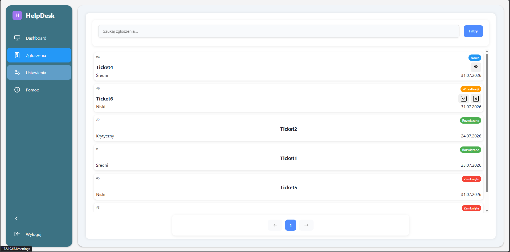

### Settings

Strona ustawień umożliwia użytkownikom zmianę nazwy użytkownika, adresu e-mail i hasła lub usunięcie konta.

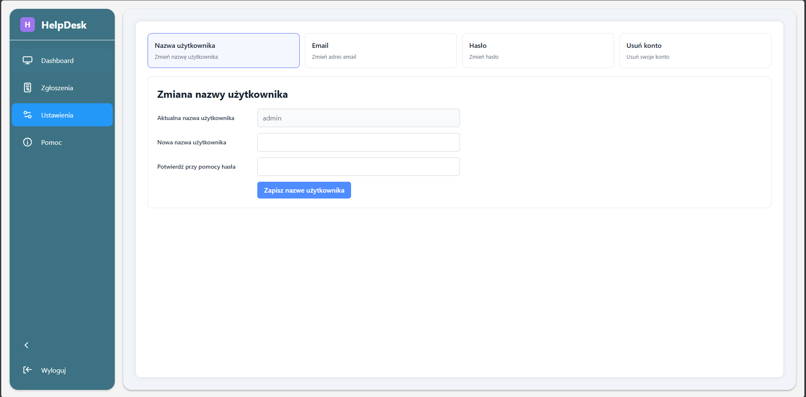

### Help

Strona pomocy zawiera informacje i wskazówki dotyczące korzystania z HelpDesk.


### Login

Projekt zawiera również stronę logowania. Obecnie nie jest ona zarejestrowana jako ścieżka w pliku `frontend/src/routes/AppRoutes.jsx`.

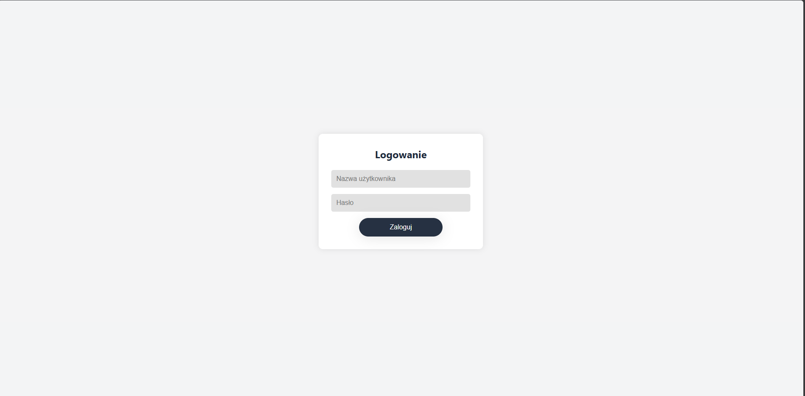

## Funkcjonalności

### Pasek nawigacyjny (Sidebar)

Pasek boczny zapewnia nawigację między panelem głównym, zgłoszeniami, ustawieniami i pomocą. Można go zwinąć, a przycisk wylogowania kończy sesję użytkownika.

Pasek rozwinięty

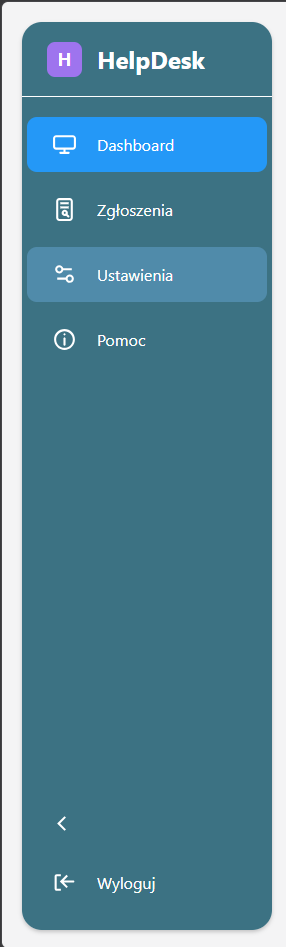

Pasek zwinięty

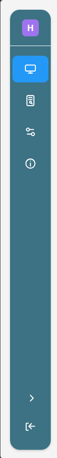

### Tworzenie zgłoszeń

Formularz na panelu użytkownika pozwala utworzyć zgłoszenie, podając tytuł, opis, kategorię i priorytet oraz opcjonalne tagi.


### Lista, wyszukiwanie i filtrowanie zgłoszeń

Lista zgłoszeń prezentuje ich status, priorytet i datę. Wyszukiwarka i filtry umożliwiają zawężenie wyników według statusu, priorytetu, kategorii i zakresu dat. Lista obsługuje również stronicowanie.


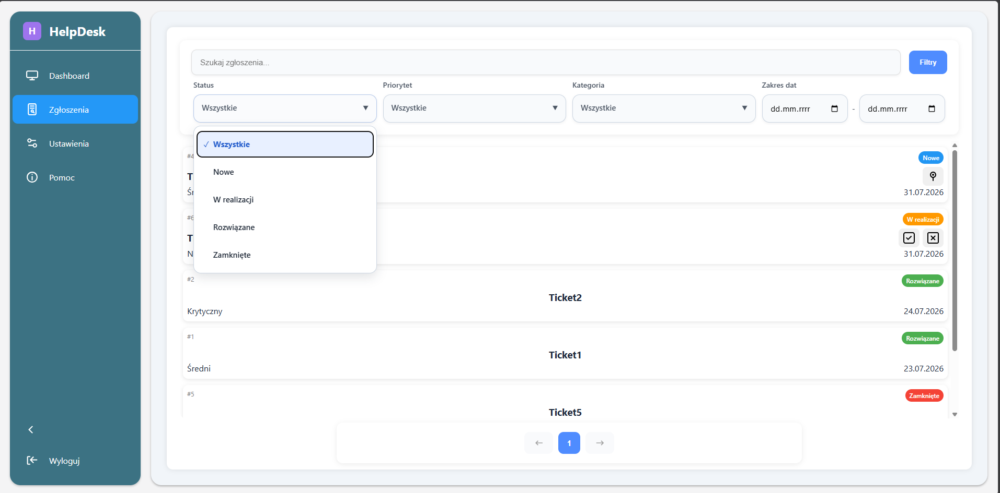

### Szczegóły zgłoszenia: TicketDrawer i TicketWindow

Wybranie zgłoszenia otwiera widok szczegółów:

- **TicketDrawer** otwiera się z panelu głównego. Pokazuje opis, autora, status, priorytet, kategorię i rozmowę. Użytkownicy mogą odpowiadać w rozmowie, a administratorzy mogą przypisać sobie aktywne zgłoszenie lub zmienić jego status.
- **TicketWindow** otwiera się na stronie zgłoszeń. Pokazuje przebieg i status zgłoszenia. Administratorzy mogą przypisać zgłoszenie, oznaczyć je jako rozwiązane lub zamknąć. Widok obsługuje publiczne wiadomości i notatki wewnętrzne.

TicketDrawer — szczegóły zgłoszenia otwierane z panelu głównego:

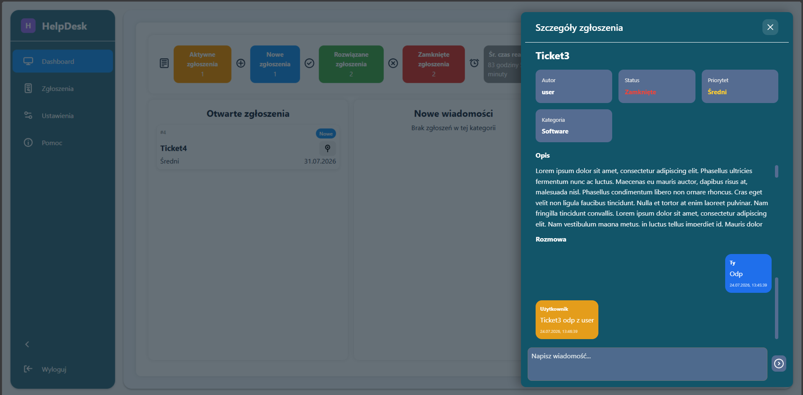

TicketWindow — szczegóły zgłoszenia otwierane ze strony zgłoszeń:

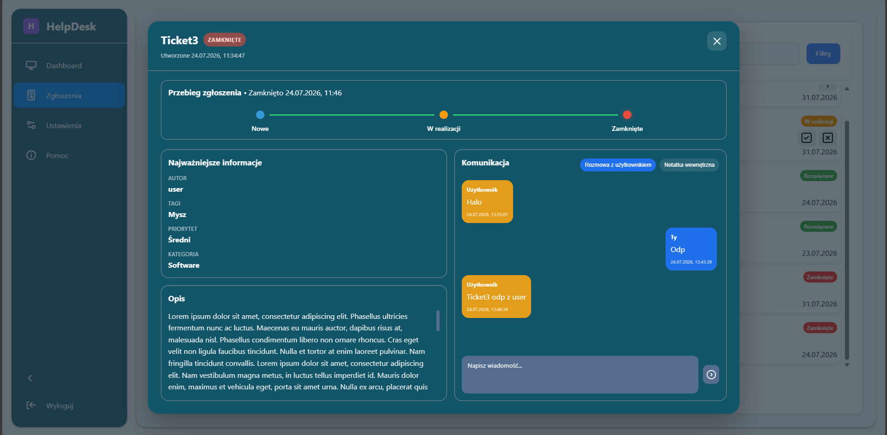

### Statystyki administratora

Panel administratora prezentuje liczbę aktywnych, nowych, rozwiązanych i zamkniętych zgłoszeń oraz średni czas ich realizacji.

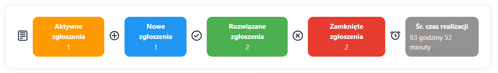

## Routes

| Page | Path |
| --- | --- |
| Dashboard | `/dashboard` |
| Tickets | `/tickets` |
| Settings | `/settings` |
| Help | `/help` |

## Development

Z katalogu frontend zainstaluj dependecies i uruchom lokalny serwer deweloperski:

```sh
npm install
npm run dev
```

Aby utworzyć kompilację produkcyjną lub sprawdzić kod za pomocą ESLint:

```sh
npm run build
npm run lint
```
